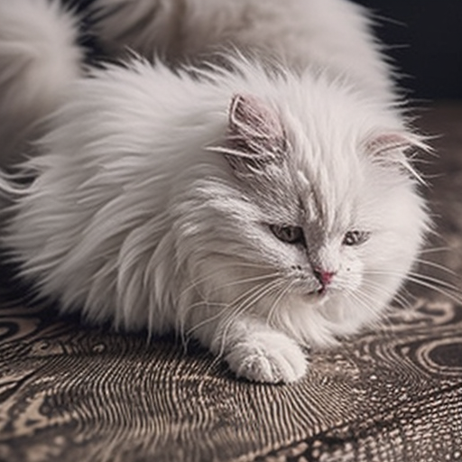

# Cat Image Generator

I'm doing the Hugging Face AI Agents course. In the Dummy Agent Library section, the hosted inference the course uses now requires paid credits, so I couldn't finish the agent exercises that way.

Instead, I ran a small free model in Google Colab and completed the cat image task with it.

## What it does
`generate_cat.py` generates a cat image from a text prompt using the free `stabilityai/sd-turbo` model. No paid API or token is needed.

## Run it
In Google Colab (each command starts with `!`):
```
!pip install -r requirements.txt
!python generate_cat.py
```

On your own computer:
```
pip install -r requirements.txt
python generate_cat.py
```

Custom prompt:
```
python generate_cat.py --prompt "a black cat sleeping on a sofa" --output outputs/black_cat.png
```

## Result
Output from my Colab run:



## Files
- `generate_cat.py`: the image generation script
- `requirements.txt`: Python dependencies
- `README.md`: this file

See [UNIT2_SMOLAGENTS.md](UNIT2_SMOLAGENTS.md) for the smolagents tasks from the Hugging Face Agents course.
