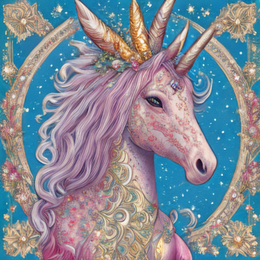

# Party Playlist RAG

A beginner project where I tested RAG (retrieval-augmented generation) and an image model, in Google Colab.

## What I did
1. **Retrieval:** I made a small list of text notes. When I asked a question, the code searched the notes for the closest match. If nothing was close enough, it refused to answer.
2. **Traditional RAG:** the code does the search, and no AI model decides anything. It answers or refuses.
3. **Agentic RAG:** a small language model (Qwen) writes the search query, checks if the notes answer the question, and tries again. I capped it at 3 tries.
4. **Song picker:** the code searches a song list, then the AI picks songs only from what it found.
5. **Image:** the code gets style notes, the AI writes a picture prompt from them, and an image model (Stable Diffusion, sd-turbo) draws the picture.

**Important:** the songs in my notebook are placeholders I made up for testing. They are not real tracks, so these results show how the pipeline works, not what good party music is.

## Song picker (short)
- I used a placeholder song list I made up for testing. These are not real tracks.
- The code searched the list, and the AI picked from what it found.
- The picker chose two dark tracks and skipped the chill one. One run only.

## Short results
- Questions outside my notes got refused, which is what I wanted.
- Traditional RAG refused quickly. Agentic RAG also refused, but used 3 AI calls each time, so it cost more.
- The AI sometimes ignored my rules. It repeated a search, and it added details to the image prompt that were not in my notes.
- When the song picker had a "not in list" option, it refused even with a good match. Without that option, it picked the right songs and skipped the wrong one. This was one run only.
- The image rule check (no banned words like "blue") failed 3 times, so the code stopped and did not make an image from that prompt.

## What decides what
The code decides when to stop, what counts as a match, and when to refuse. The AI only suggests search queries and gives yes or no answers, and the code checks those. So it is more of a workflow with an AI step than a fully free agent.

## What went wrong (and what I learned)
1. **Search wandered off.** The AI rewrote "dark party songs" into "spooky night out." Lesson: a rewrite can drift from the question.
2. **Repeated searches.** I told the AI not to repeat searches, and it did anyway. Lesson: a prompt is a request; code has to enforce rules.
3. **Too easy to say yes.** For "how do I cut texts," the AI said the notes answered it when they only defined chunking, then wrote a long answer the notes did not support.
4. **Expensive refusals.** Agentic RAG made 3 AI calls to refuse what the simple search had already refused for free.
5. **"Not in list" with a match.** The picker had a good match but still answered "Not in list." Lesson: print the search results and the raw AI answer separately to find where it broke.
6. **Capital letters.** I asked for "NOT IN LIST" and got "Not In List." Fix: compare text without caring about capitals.
7. **NameError.** I used a variable from a cell I had not run yet. Lesson: run cells in order.
8. **Invented details in the image prompt.** It included pink, silver, glowing, and blue, which were not in my notes. My check caught it.
9. **Retries did not help.** The check found "blue" on all 3 tries, so the code refused to make the image. Lesson: a rule in the prompt is not a guarantee.
10. **The picture added things I never wrote.** You can limit a picture with a prompt, but not fully control it. You check it by looking.
11. **A pass that meant nothing.** My song check said "nothing mentioned," but only because the picker refused. Lesson: a check that passes because nothing happened is not a real pass.
12. **Only one test run.** I need more runs before I trust the song picker.

## Image: how it was made
RAG cannot make images. It only finds text. So I split the job into three steps:

1. **RAG (retrieval):** the code searched my style notes about unicorns and found the closest ones (for example, "colorful unicorns often have rainbow or pastel manes," and "unicorn horns are commonly gold or pearl white").
2. **LLM (prompt writer):** the language model read those notes and wrote one picture prompt. The LLM does not draw anything. It only writes words.
3. **Diffusion model (drawing):** the image model (Stable Diffusion, sd-turbo) read the prompt and drew the picture. It starts from random noise and removes the noise step by step, guided by the prompt.

What I checked:
- The LLM's prompt added a silver mane, a pink dress, and glowing blue eyes. None of those were in my notes.
- My rule check (no banned words) failed on every retry, so the code refused to make an image from that prompt.
- The picture I generated came from the earlier prompt, which had those extra details. It also added a gold frame and a starry background, which I never wrote.

Lesson: RAG can keep the text grounded in my notes. It cannot control what the drawing adds. You check an image by looking at it.

## Files
- `README.md`: this file
- `unicorn.png`: the generated image
- `party_playlist_rag.ipynb`: the Colab notebook (File → Download → .ipynb in Colab)
